# 가계부 사용자 설명서 (v0.11.0)

> 처음 쓰는 가족도 3분이면 익숙해지도록, 실제 화면과 함께 쉬운 말로 정리했습니다.  
> 앱에서는 사이드바 아래쪽(휴대폰은 **더보기 → 도움말**)의 **사용자 설명서**에서 같은 내용을 볼 수 있습니다.

<!-- 이 파일은 apps/web/src/manual.ts에서 만듭니다. 직접 고치지 말고 manual.ts를 고친 뒤 `pnpm manual:md`를 실행하세요. -->

---

## 처음이라면 여기부터! (3분 빠른 시작)

1. **카드·계좌 등록하기**  
   설정 → 카드·계좌에서 가족이 쓰는 카드와 통장을 넣으세요. 카드사와 끝 4자리를 넣어 두면 결제 문자와 파일이 저절로 연결됩니다.
2. **거래 기록하기**  
   추가에서 금액 → 분류 → 저장 3단계로 바로 적거나, 설정 → 문자 전달로 카드 결제 문자가 자동으로 들어오게 하세요.
3. **홈에서 확인하기**  
   홈에서 이번 달 지출·수입, 예산을 얼마나 썼는지, 분류별 비율을 한눈에 보세요.

---

## 목차

- [1. 홈 — 이번 달 한눈에 보기](#1-홈--이번-달-한눈에-보기)
- [2. 내역 — 거래 찾고 고치기](#2-내역--거래-찾고-고치기)
- [3. 추가 — 3단계로 빠르게 적기](#3-추가--3단계로-빠르게-적기)
- [4. 인박스 — 확인이 필요한 것만 모아 정리](#4-인박스--확인이-필요한-것만-모아-정리)
- [5. 가져오기 — 엑셀·CSV 파일로 한꺼번에](#5-가져오기--엑셀csv-파일로-한꺼번에)
- [6. 통계 — 1년 흐름 보기](#6-통계--1년-흐름-보기)
- [7. 예산 — 한 달에 쓸 돈 정하고 지켜보기](#7-예산--한-달에-쓸-돈-정하고-지켜보기)
- [8. 설정 — 한곳에서 관리하기](#8-설정--한곳에서-관리하기)
- [8-1. 보안 — Face ID, 앱 잠금, 비밀번호](#8-1-보안--face-id-앱-잠금-비밀번호)
- [8-2. 카드·계좌 — 결제 수단 등록](#8-2-카드계좌--결제-수단-등록)
- [8-3. 분류 — 지출·수입 분류 정리](#8-3-분류--지출수입-분류-정리)
- [8-4. 문자 전달 — 카드 결제 문자 자동 기록](#8-4-문자-전달--카드-결제-문자-자동-기록)
- [8-5. 분류 규칙 — 가맹점별 자동 분류](#8-5-분류-규칙--가맹점별-자동-분류)
- [8-6. 고정지출 — 매달 나가는 돈 챙기기](#8-6-고정지출--매달-나가는-돈-챙기기)
- [8-7. 백업·내보내기 — CSV로 받기](#8-7-백업내보내기--csv로-받기)
- [8-8. 구성원 — 가족 초대 (관리자)](#8-8-구성원--가족-초대-관리자)
- [9. 로그인·잠금 — Face ID로 바로 들어가기](#9-로그인잠금--face-id로-바로-들어가기)
- [10. 버전 이력 — 새로 바뀐 것 확인하기](#10-버전-이력--새로-바뀐-것-확인하기)
- [용어 풀이](#용어-풀이)
- [자주 묻는 질문](#자주-묻는-질문)

---

## 1. 홈 — 이번 달 한눈에 보기

_이번 달에 얼마나 쓰고 벌었는지, 예산은 괜찮은지 가장 먼저 보는 화면입니다._

**언제 쓰나요?** “이번 달 얼마 썼지?”, “식비 예산 아직 남았나?”가 궁금할 때 엽니다.

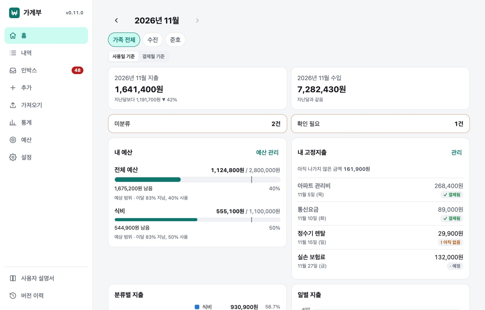

- **달 바꾸기와 보기 범위**: 위쪽 ‹ › 로 다른 달을 봅니다(이번 달보다 뒤로는 못 갑니다). 구성원에게는 자기 거래만 보입니다. 관리자는 「가족 전체」나 한 사람 이름을 눌러 그 사람 것만 볼 수 있습니다.
- **지출·수입 합계**: 이번 달 지출과 수입, 지난달보다 얼마나 늘거나 줄었는지 보여 줍니다. 카드를 누르면 그 내역으로 바로 갑니다. 이체와 취소된 거래는 합계에서 빠집니다.
- **사용일 기준 · 결제월 기준**: 「결제월 기준」을 누르면 신용카드 거래를 결제일에 실제로 돈이 나가는 달로 셉니다. 합계는 「나가는 돈」으로 바뀌고, 일별 그래프에서는 카드값이 결제일에 모여 보입니다. 예산은 계속 쓴 날 기준입니다. 고른 기준은 이 기기에서 기억되어 내역·통계에도 똑같이 적용됩니다.
- **미분류·확인 필요**: 분류가 없는 거래나 확인이 필요한 거래가 있으면 「미분류 N건」, 「확인 필요 N건」 카드가 나옵니다. 누르면 해당 거래만 모아 봅니다.
- **예산 카드**: 예산은 사람마다 따로 정하고, 그 사람이 쓴 돈으로 셉니다. 관리자가 「가족 전체」로 보면 「내 예산」, 구성원 이름을 고르면 「○○의 예산」이 나옵니다. 전체 예산과 많이 쓴 분류 예산 3개까지 막대로 보여 줍니다. 막대 위 세로선은 이번 달이 얼마나 지났는지입니다. 쓴 비율이 지난 비율보다 10%p 넘게 앞서면 「예상보다 빠름」, 넘으면 막대가 쓴 돈 전체를 나타내고, 흰 세로선이 예산 금액, 그 뒤의 빗금 부분이 넘은 만큼입니다. 아래에 「N원 초과」도 함께 나옵니다.
- **고정지출 카드**: 내 고정지출(관리자가 구성원을 고르면 그 사람의 것)이 이번 달에 「✓ 결제됨」, 「· 예정」, 「! 아직 없음」 중 어디인지와 아직 나가지 않은 금액을 보여 줍니다.
- **분류별 지출과 일별 지출**: 도넛 차트로 분류별 비율을, 막대로 날마다 쓴 금액을 봅니다. 분류 이름을 누르면 그 분류의 내역이 열리고, 「표로 보기」로 숫자 표를 볼 수 있습니다.

> **알아 두면 좋아요**: 맨 아래에 「서버 연결됨」이 보이면 정상입니다. 「서버에 연결할 수 없습니다」가 나오면 휴대폰의 Tailscale 연결을 확인하세요.

---

## 2. 내역 — 거래 찾고 고치기

_한 달 동안의 모든 거래를 날짜별로 보고, 찾고, 고칩니다._

**언제 쓰나요?** “지난주 마트에서 얼마 썼더라?”처럼 특정 거래를 찾거나, 잘못 들어간 분류를 고칠 때 씁니다.

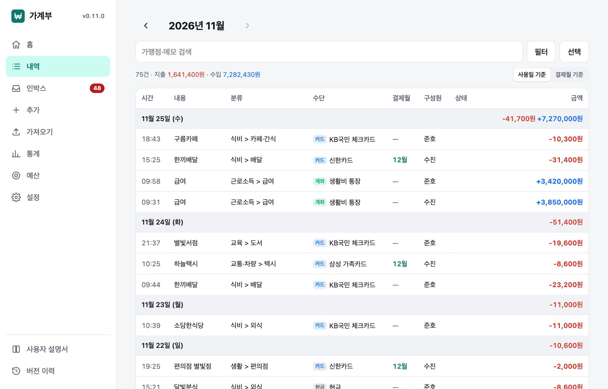

- **검색과 필터**: 검색창에 가맹점이나 메모를 넣으면 바로 찾아 줍니다. 「필터」에서 유형(지출·수입·이체), 분류, 수단, 상태, 최소·최대 금액(관리자는 구성원도)으로 거를 수 있고, 위에 생긴 칩의 ✕로 하나씩 풉니다.
- **거래 줄 보는 법**: 「문자」는 결제 문자로, 「파일」은 파일 가져오기로 들어온 거래이고, 「확인됨」은 두 곳 이상에서 같은 거래가 확인됐다는 뜻입니다. 「취소」, 「확인 필요」 표시도 붙습니다. 수단 앞에는 카드·계좌·간편결제·현금 구분이 색깔 표시로 붙습니다. 금액은 지출은 빨간색(-), 수입은 파란색(+), 이체는 회색으로 보이고, 날짜별·한 달 합계도 같은 색으로 나옵니다.
- **결제월**: 결제일을 넣어 둔 신용카드 거래에는 그 돈이 실제로 빠져나가는 달(예: 「12월 결제」)이 함께 보입니다. 쓴 달과 결제월이 다르면 초록색으로 강조합니다. 넓은 화면에서는 「결제월」 칸에 나옵니다.
- **사용일 기준 · 결제월 기준**: 합계 옆 버튼으로 바꿉니다. 「결제월 기준」을 고르면 카드는 결제일에 빠져나가는 달로, 통장·현금 등은 쓴 날로 모아 보여 줍니다. “이번 달에 통장에서 실제로 얼마 나가나?”를 볼 때 쓰세요. 홈·통계와 같은 기준을 쓰고, 고른 기준은 기억됩니다.
- **거래 고치기**: 거래를 누르면 금액, 분류, 가맹점, 날짜, 수단, 누구 것, 메모, 상태를 바꿀 수 있습니다. 분류를 바꿀 때 「이 가맹점은 앞으로도 이렇게」를 체크하면 같은 가맹점은 다음부터 자동으로 그 분류가 됩니다.
- **한꺼번에 고치기**: 「선택」을 누르면 거래 앞에 체크 칸이 생깁니다. 거래를 하나씩 누르거나, 날짜 옆 칸으로 그날 거래를 모두, 아래 막대의 「N건 모두」로 지금 조건(검색·필터)에 맞는 거래를 모두 고릅니다. 넓은 화면에서는 Shift를 누른 채 누르면 사이의 거래가 한꺼번에 골라집니다. 「한꺼번에 고치기」에서 분류, 결제수단, 유형, 상태 중 바꿀 것만 고르세요. 분류를 고르면 유형도 그 분류에 맞게 바뀝니다(예: 이체 → 지출).
- **삭제**: 거래 수정 창의 「삭제」로 지웁니다. 지운 거래는 되돌릴 수 없으니, 잠깐 빼 두고 싶으면 상태를 「취소」로 바꾸세요(합계에서 빠집니다).

> **알아 두면 좋아요**: 같은 가맹점을 한 번에 고치려면 검색창에 가맹점 이름을 넣고 「선택」 → 「N건 모두」 → 「한꺼번에 고치기」를 누르세요. 「이 가맹점들은 앞으로도 이 분류로」를 체크하면 다음부터 자동으로 분류됩니다.

---

## 3. 추가 — 3단계로 빠르게 적기

_현금 결제나 문자가 오지 않는 거래를 직접 적습니다._

**언제 쓰나요?** 시장에서 현금을 썼거나, 용돈·월급 같은 수입을 적을 때 씁니다.

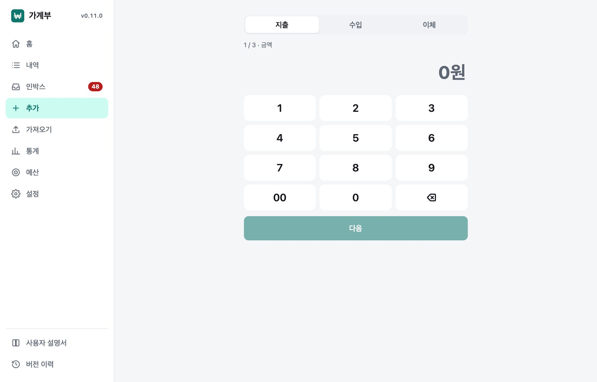

- **1단계 · 금액**: 맨 위에서 지출·수입·이체를 고르고 숫자 키패드로 금액을 넣은 뒤 「다음」을 누릅니다. 컴퓨터에서는 키보드 숫자·Backspace·Enter도 됩니다.
- **2단계 · 분류**: 「최근」에 자주 쓴 분류가 먼저 나옵니다. 상위 분류를 누르면 하위 분류가 펼쳐집니다. 정하기 어려우면 「분류 없이 저장 (미분류)」을 누르세요. 이체는 이 단계를 건너뜁니다.
- **3단계 · 저장**: 가맹점·내용, 수단, 날짜·시간(기본은 지금), 누구 것, 메모를 넣고 「저장」합니다. 가맹점만 적고 분류를 비워 두면 자동으로 분류해 줍니다.
- **이어서 적기**: 저장하면 「저장했습니다」 안내가 뜨고 첫 단계로 돌아갑니다. 유형·수단·누구 것은 그대로 남아 있어 여러 건을 연달아 적기 편합니다.

> **알아 두면 좋아요**: 등록한 카드·계좌가 없으면 3단계에서 「현금 수단 만들기」로 현금 지갑을 바로 만들 수 있습니다.

---

## 4. 인박스 — 확인이 필요한 것만 모아 정리

_자동으로 처리하지 못한 거래를 모아 두는 곳입니다. 한 번 누르면 처리됩니다._

**언제 쓰나요?** 메뉴의 인박스 옆에 빨간 숫자가 보일 때 엽니다.

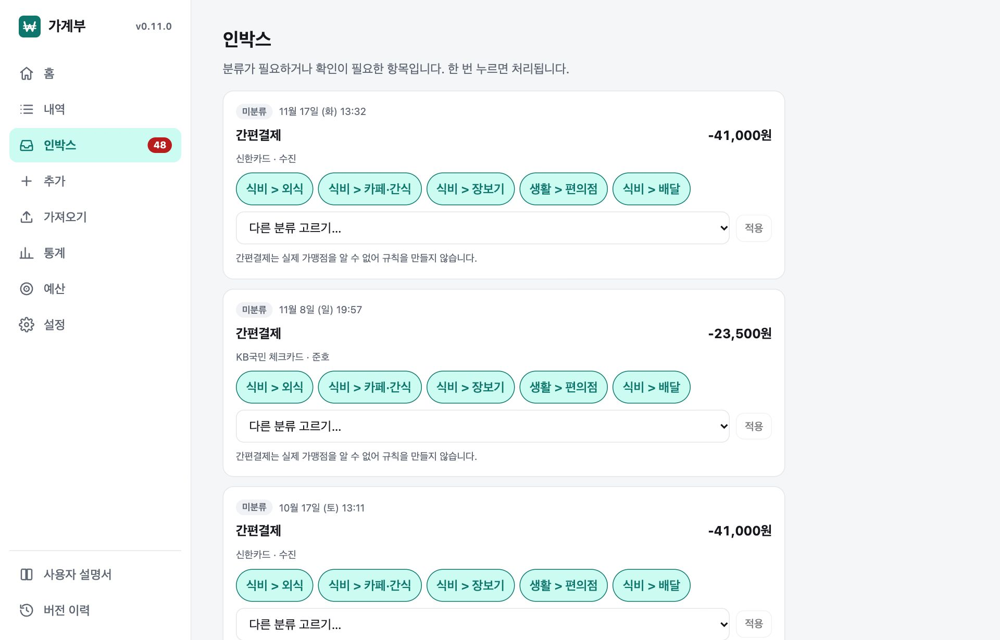

- **미분류**: 분류가 없는 거래입니다. 추천 분류를 한 번 누르거나 「다른 분류 고르기…」로 고릅니다. 「앞으로도 이렇게」가 켜져 있으면 같은 가맹점은 다음부터 자동 분류됩니다.
- **해석 실패**: 결제 문자 같지만 금액·날짜·가맹점을 읽지 못한 문자입니다. 원래 문자를 보며 빈칸을 채워 「거래로 등록」하거나 「무시」합니다.
- **새 카드**: 등록되지 않은 카드로 결제 문자가 왔습니다. 「이 카드 등록」을 누르면 카드를 만들고 그동안 온 거래도 함께 연결합니다.
- **취소 문자**: 취소 문자가 왔는데 원래 거래를 찾지 못했습니다. 후보 중에서 「이 거래 취소」를 고릅니다.
- **중복 확인**: 직접 적은 거래와 같은 결제 문자가 왔을 수 있습니다. 같은 거래면 「같은 거래」, 아니면 「다른 거래로 등록」을 누릅니다.

> **알아 두면 좋아요**: 미분류는 내 거래만(관리자는 가족 모두의 것) 보이고, 문자 관련 항목은 그 문자를 보낸 사람에게만 보입니다.

---

## 5. 가져오기 — 엑셀·CSV 파일로 한꺼번에

_뱅크샐러드나 카드사·은행에서 받은 파일로 빠진 거래를 채웁니다._

**언제 쓰나요?** 한 달에 한 번, 문자로 들어오지 않은 거래(다른 카드사, 은행 이체 등)를 맞춰 볼 때 씁니다.

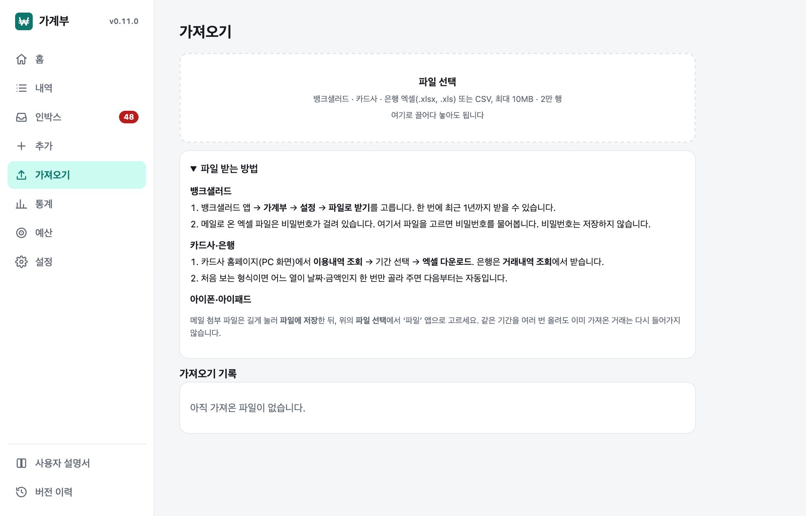

- **파일 고르기**: 「파일 선택」을 누르거나 파일을 끌어다 놓습니다. 엑셀(.xlsx, .xls)과 CSV, 최대 10MB · 2만 행까지 됩니다. 비밀번호가 걸린 파일은 비밀번호를 물어보고, 비밀번호는 저장하지 않습니다.
- **열 맞추기**: 열 이름을 알아보지 못하면 날짜·금액·가맹점이 어느 열인지 직접 고릅니다. 같은 형식의 파일은 다음부터 저절로 맞춥니다.
- **미리보기**: 반영하기 전에 신규, 중복, 확인 필요, 이체 추정 등으로 나눠 보여 줍니다. 파일의 결제수단과 분류를 우리 집 카드·계좌와 분류에 연결하고, 「확인 필요」를 모두 정한 뒤 「N건 반영」을 누릅니다.
- **겹쳐 올려도 안전**: 전에 가져온 줄은 기억해 두어 같은 파일이나 겹치는 기간을 다시 올려도 늘어나지 않습니다. 그 뒤 고치거나 지운 거래도 다시 들어오지 않습니다.
- **되돌리기**: 아래 「가져오기 기록」에서 「가져오기 취소」를 누르면 그 파일로 추가된 거래를 지우고 연결을 풉니다. 반영하지 않은 미리보기는 24시간 뒤 지워집니다.

> **알아 두면 좋아요**: 아이폰에서는 메일로 받은 파일을 길게 눌러 「파일에 저장」한 뒤, 가져오기 화면의 「파일 선택」으로 고르세요.

---

## 6. 통계 — 1년 흐름 보기

_최근 12개월이나 한 해 동안의 지출·수입 흐름을 봅니다._

**언제 쓰나요?** “작년보다 식비가 늘었나?”, “어느 가맹점에 제일 많이 썼지?”가 궁금할 때 엽니다.

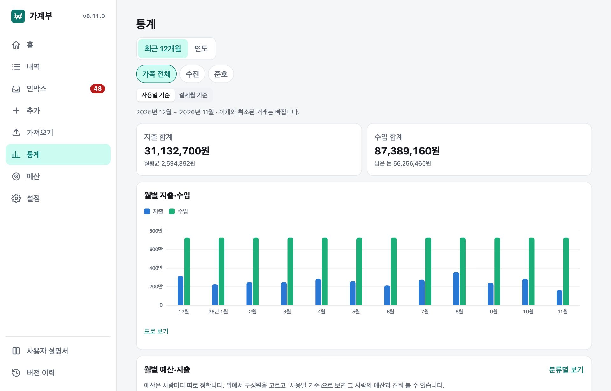

- **기간 고르기**: 「최근 12개월」 또는 「연도」를 고릅니다. 연도에서는 작년과 비교하고, 올해처럼 아직 끝나지 않은 해는 작년의 같은 기간끼리 비교합니다.
- **월별 지출·수입**: 달마다 지출과 수입을 막대로 봅니다. 막대를 누르면 그 달의 내역이 열립니다. 전체 예산을 넘은 달은 지출 막대에 예산 금액 자리가 흰 가로선으로, 그 위로 넘은 만큼이 빗금으로 표시됩니다.
- **월별 예산·지출**: 달마다 전체 예산(회색)과 지출(파란색)을 나란히 봅니다. 넘은 달은 지출 막대에 예산 자리 흰 가로선과 넘은 만큼의 빗금이 있고, 위에 「N달 중 M달 넘었습니다」가 나옵니다. 주황 점선은 지출의 「최근 3달 평균」으로, 들쭉날쭉한 달을 눌러 흐름을 보여 줍니다(진행 중인 이번 달은 빠집니다). 그 아래 한두 줄로 최근 3달과 그 전 3달의 평균 지출 비교, 예산이 바뀌었으면 평균 사용률 변화, 몇 달 연속 예산 안에서 썼는지(넘었는지)를 알려 줍니다. 예산이 있던 지난 달이 4달 미만이면 이 설명은 나오지 않습니다. 「표로 보기」에서 달마다 예산, 지출, 얼마나 넘었는지(남았는지)를 봅니다. 예산 막대를 누르면 그 달 예산 화면이, 지출 막대를 누르면 그 달 내역이 열립니다. 「분류별 보기」는 예산 화면의 「월별 비교」로 갑니다. 예산은 사람마다 따로 정하고 그 사람이 쓴 날 기준으로 세므로 「사용일 기준」으로 볼 때만 나옵니다. 관리자는 구성원 한 사람(자기 자신 포함)을 골라야 그 사람의 예산과 견줘 볼 수 있습니다.
- **월별 분류 예산·지출**: 식비·쇼핑처럼 분류 예산을 정한 분류마다 같은 그래프를 봅니다. 위의 분류 버튼으로 바꿔 보세요. 예산과 지출 막대, 넘은 만큼의 빗금, 최근 3달 평균 점선, 추이 설명, 「표로 보기」가 「월별 예산·지출」과 같고, 지출 막대를 누르면 그 달 그 분류의 내역이 열립니다. 예산을 정하기 전 달도 지출과 점선은 보여서 예산을 얼마로 잡을지 참고할 수 있습니다. 「한눈에 비교」는 예산 화면의 「월별 비교」로 갑니다.
- **분류별 지출 추이**: 많이 쓴 분류 6개와 나머지(기타)를 쌓은 막대로 봅니다. 「달마다 보기」로 달·분류별 표를 볼 수 있습니다. 「예산 대비 보기」를 누르면 예산 화면의 「월별 비교」로 갑니다.
- **구성원별 지출과 많이 쓴 가맹점**: 많이 쓴 가맹점 순위를 보여 줍니다. 관리자가 「가족 전체」로 보면 누가 얼마나 썼는지(거래의 「누구 것」 기준)도 나옵니다.

> **알아 두면 좋아요**: 그래프마다 같은 내용의 「표로 보기」가 있습니다. 이체와 취소된 거래는 빠집니다. 「결제월 기준」을 누르면 신용카드 거래를 결제되는 달로 모아, 달마다 통장에서 실제로 나간 돈의 흐름을 볼 수 있습니다.

---

## 7. 예산 — 한 달에 쓸 돈 정하고 지켜보기

_한 달 전체 예산과 신경 쓰이는 분류의 예산을 정하고, 달마다 얼마나 지켰는지 봅니다._

**언제 쓰나요?** 새로 예산을 정하거나 금액을 바꿀 때, “식비 예산을 몇 달이나 넘겼지?”가 궁금할 때 씁니다. 이번 달 진행 상황은 홈에서도 볼 수 있습니다.

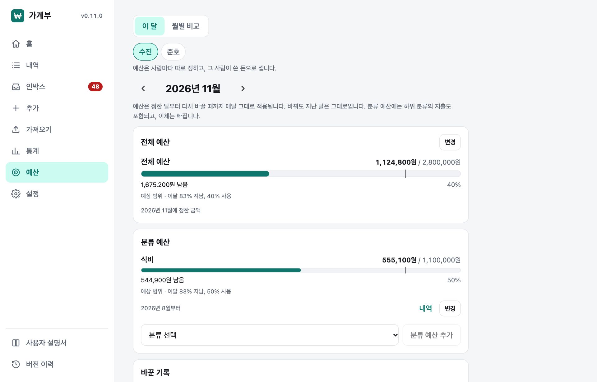

- **내 예산**: 예산은 사람마다 따로 정합니다. 내가 정한 예산은 내가 쓴 돈으로만 세고, 다른 구성원에게는 보이지 않습니다. 관리자는 위쪽 이름 버튼으로 구성원을 골라 그 사람의 예산을 보고 대신 정할 수도 있습니다.
- **전체 예산**: 「정하기」(이미 있으면 「변경」)로 한 달 동안 쓸 금액을 넣습니다.
- **분류 예산**: 식비·쇼핑처럼 상위 지출 분류에만 따로 정할 수 있습니다. 하위 분류의 지출도 함께 셉니다.
- **정한 달부터 계속**: 예산은 정한 달부터 다시 바꿀 때까지 매달 그대로 적용됩니다. 바꿔도 지난 달은 그대로이고, 남은 돈이 다음 달로 넘어가지는 않습니다. 「이 달부터 예산 없애기」로 끌 수 있습니다.
- **바꾼 기록**: 언제 얼마로 바꿨는지 남습니다. 관리자가 대신 바꿨다면 바꾼 사람 이름도 함께 보입니다.
- **월별 비교**: 위쪽 「월별 비교」를 누르면 최근 12개월(또는 6개월) 동안 예산마다 쓴 비율을 한 표로 봅니다. 넘은 달은 빗금 칸에 「!」 표시, 80% 넘게 쓴 달은 옅은 주황, 이번 달처럼 아직 진행 중인 달은 점선 테두리로 보입니다. 「—」는 그 달엔 예산이 없었다는 뜻입니다.
- **칸과 분류 이름 누르기**: 칸을 누르면 그 달·그 분류의 내역이 열립니다. 분류 이름을 누르면 달마다 쓴 돈(막대)과 예산(점선)을 겹친 그래프(넘은 달은 예산 자리에 흰 가로선, 그 위로 넘은 만큼이 빗금), 넘은 횟수, 평균 사용률이 나옵니다. 휴대폰에서는 표를 옆으로 밀어 지난 달을 봅니다.
- **예산 없는 지출**: 그 달에 예산이 없던 분류와 미분류 지출을 합친 금액입니다. 분류 예산 밖에서 얼마나 썼는지 확인할 때 봅니다.

> **알아 두면 좋아요**: 월별 비교의 평균 사용률과 합계는 아직 끝나지 않은 이번 달을 빼고 계산합니다. 보관한 분류의 예산은 표에 나오지 않습니다.

---

## 8. 설정 — 한곳에서 관리하기

_보안, 카드·계좌, 분류, 문자 전달, 규칙, 고정지출, 백업을 여기서 엽니다._

**언제 쓰나요?** 처음 준비할 때와, 카드가 바뀌거나 분류를 정리하고 싶을 때 엽니다.

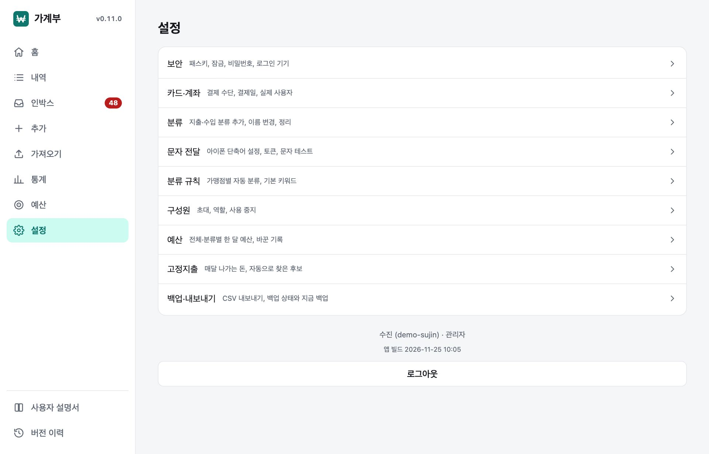

- **메뉴**: 보안, 카드·계좌, 분류, 문자 전달, 분류 규칙, 예산, 고정지출, 백업·내보내기가 있습니다. 관리자에게는 「구성원」도 보입니다.
- **내 계정과 앱 빌드**: 아래쪽에 내 이름·아이디와 역할(관리자/구성원), 지금 쓰는 앱 빌드 시각이 나옵니다. 「로그아웃」도 여기 있습니다.

---

## 8-1. 보안 — Face ID, 앱 잠금, 비밀번호

_로그인 방법과 앱 잠금, 로그인된 기기를 관리합니다._

**언제 쓰나요?** 새 기기에 Face ID를 추가하거나, 잠금 시간을 바꾸거나, 잃어버린 기기를 로그아웃시킬 때 씁니다.

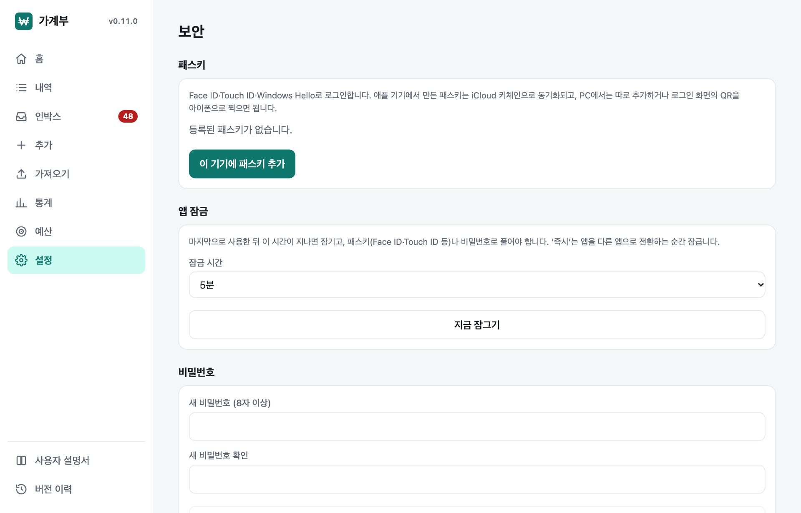

- **패스키**: 「이 기기에 패스키 추가」로 Face ID·Touch ID·Windows Hello 로그인을 켭니다. 아이폰에서 만든 패스키는 iCloud 키체인으로 같은 Apple 계정의 아이패드·맥에도 동기화됩니다.
- **앱 잠금**: 「잠금 시간」을 즉시 / 5분 / 1시간 / 끔 중에서 고릅니다. 잠기면 Face ID나 비밀번호로 풉니다. 「지금 잠그기」로 바로 잠글 수도 있습니다.
- **비밀번호와 복구 코드**: 비밀번호는 8자 이상으로 바꿉니다. 바꾸면 다른 기기의 로그인은 풀립니다. 「새 복구 코드 만들기」를 누르면 전 코드는 못 씁니다.
- **로그인된 기기**: 어떤 기기에서 로그인했는지 보고 하나씩, 또는 「다른 기기 모두 로그아웃」으로 한꺼번에 내보냅니다.

> **알아 두면 좋아요**: 패스키 삭제, 비밀번호 변경, 내보내기 같은 중요한 작업 전에는 「본인 확인」 창이 한 번 더 뜹니다. 5분 안에 확인했다면 다시 묻지 않습니다.

---

## 8-2. 카드·계좌 — 결제 수단 등록

_내가 쓰는 카드, 통장, 간편결제, 현금을 등록합니다. 구성원에게는 자기가 명의자이거나 실제 사용자인 것만 보입니다._

**언제 쓰나요?** 처음 준비할 때, 새 카드를 만들었을 때, 안 쓰는 카드를 정리할 때 씁니다.

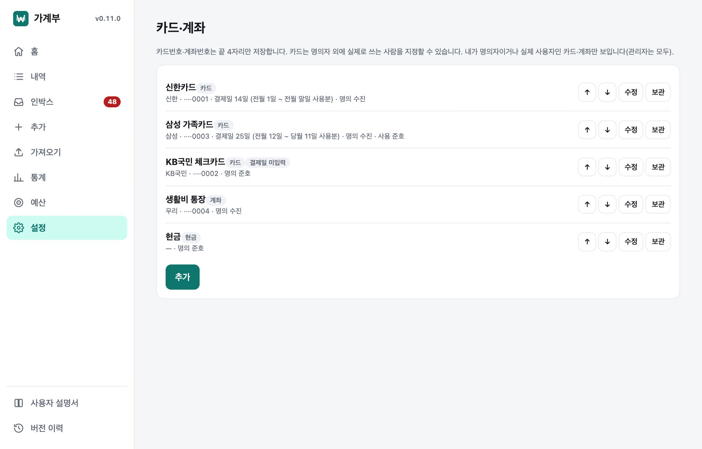

- **추가**: 종류(카드·계좌·간편결제·현금·기타), 이름, 카드사나 은행, 끝 4자리, 결제일(카드만)을 넣습니다. 번호는 끝 4자리만 저장합니다. 카카오페이·네이버페이처럼 페이로 낸 거래는 「간편결제」로 등록하세요.
- **결제일과 이용기간**: 신용카드는 결제일을 고르면 「이용기간 마감일」이 보통 값으로 저절로 채워지고, 몇 일부터 몇 일까지 쓴 돈이 그 결제일에 나가는지 보여 줍니다(예: 결제일 25일 → 전월 12일 ~ 당월 11일 사용분). 카드사 앱의 이용기간과 다르면 마감일을 고치세요. 체크카드는 결제일을 비워 두면 됩니다.
- **가져온 파일의 결제수단 연결**: 파일로 가져온 거래 중 카드·계좌가 비어 있는 것이 있으면 맨 위에 이 칸이 나옵니다. 파일에 적힌 결제수단 이름마다 「새 카드」, 「새 계좌」처럼 종류를 고르거나 이미 등록된 카드를 고른 뒤 「연결」을 누르면, 카드·계좌가 만들어지고 해당 거래에 한꺼번에 연결됩니다. 다음 가져오기부터는 같은 이름이 자동으로 연결됩니다.
- **실제 사용자**: 가족카드처럼 명의자와 쓰는 사람이 다르면 「실제 사용자」를 고르세요. 그 카드의 거래는 실제 사용자의 것으로 기록되고, 실제 사용자에게도 그 카드가 보입니다.
- **순서와 보관**: ↑ ↓ 로 순서를 바꾸고, 안 쓰는 카드는 「보관」합니다. 보관해도 지난 거래는 그대로 남고, 「보관된 항목 보기」로 다시 꺼낼 수 있습니다.

> **알아 두면 좋아요**: 카드사와 끝 4자리를 정확히 넣어 두어야 결제 문자와 파일의 거래가 그 카드에 저절로 연결됩니다.

---

## 8-3. 분류 — 지출·수입 분류 정리

_가족 모두가 함께 쓰는 상위·하위 두 단계 분류를 관리합니다._

**언제 쓰나요?** 우리 집에 맞게 분류를 더하거나 이름을 바꾸고 싶을 때 씁니다.

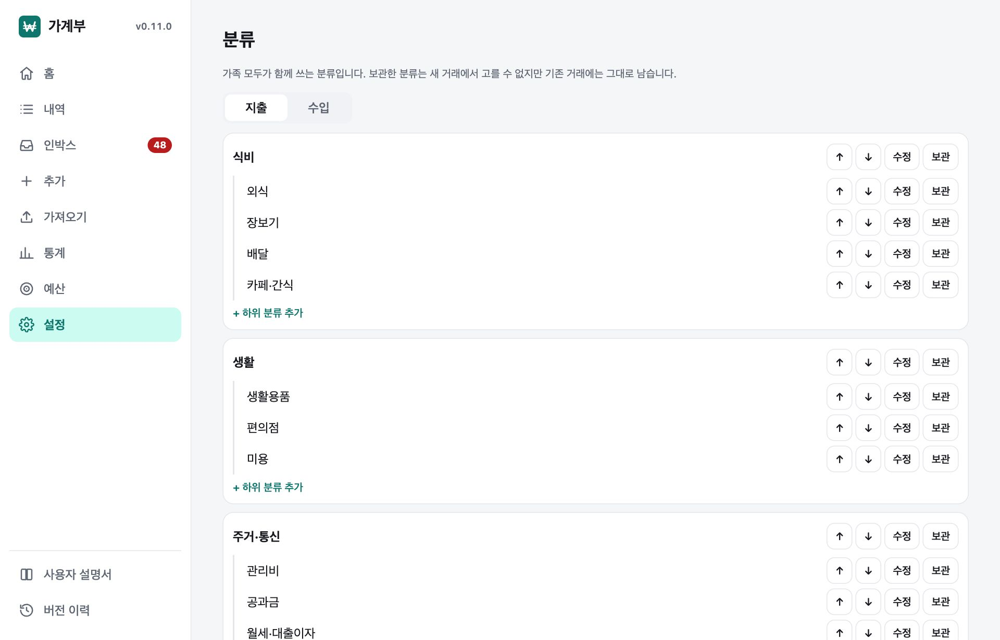

- **추가와 수정**: 「상위 분류 추가」와 각 분류의 「+ 하위 분류 추가」로 만듭니다. 「수정」에서 이름을 바꾸거나 다른 상위 분류로 옮깁니다.
- **보관**: 안 쓰는 분류는 「보관」합니다. 새 거래에서는 고를 수 없지만, 그 분류로 기록된 지난 거래는 그대로 남습니다.

---

## 8-4. 문자 전달 — 카드 결제 문자 자동 기록

_아이폰 단축어가 카드 결제 문자를 가계부로 보내 자동으로 기록하게 합니다._

**언제 쓰나요?** 새 아이폰에서 처음 설정하거나, 문자가 제대로 읽히는지 시험해 볼 때 씁니다.

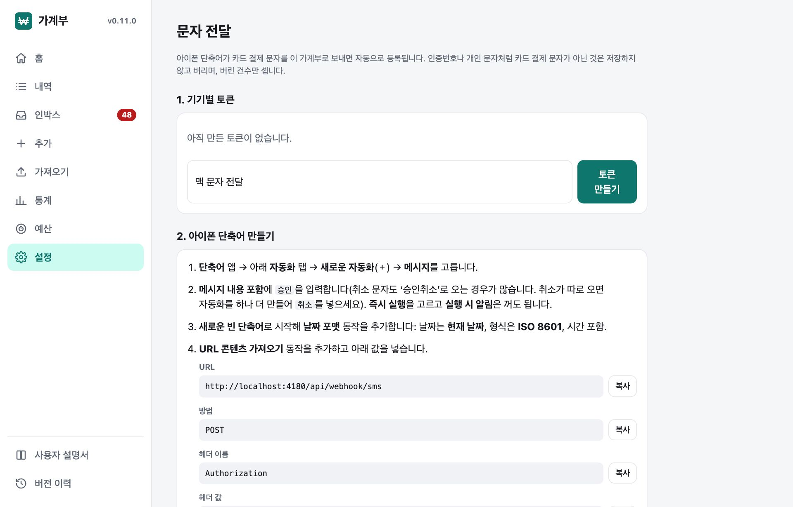

- **1. 기기별 토큰**: 기기 이름을 넣고 「토큰 만들기」를 누릅니다. 토큰은 지금 한 번만 보이니 바로 단축어에 붙여 넣으세요. 기기를 잃어버리면 「폐기」합니다.
- **2. 아이폰 단축어 만들기**: 화면에 나온 순서대로 단축어 앱 → 자동화 → 메시지(내용에 「승인」 포함)를 만들고, 복사 버튼으로 주소와 헤더, 본문을 붙여 넣습니다. 구성원마다, 기기마다 따로 설정합니다.
- **3. 문자 붙여넣기 테스트**: 받은 결제 문자를 붙여 넣고 「해석해 보기」를 누르면 카드사·금액·가맹점·분류가 어떻게 읽히는지 미리 봅니다. 이때는 저장하지 않습니다.
- **지원하는 카드사**: 지금은 신한·KB국민·삼성카드 결제 문자를 읽습니다. 다른 카드사와 은행 문자, 인증번호 같은 결제와 상관없는 문자는 저장하지 않고 버립니다.

> **알아 두면 좋아요**: 아이폰 Tailscale 앱에서 「VPN On Demand」를 켜 두세요. 연결이 끊긴 사이에 온 문자는 전달되지 않으니, 한 달에 한 번 파일 가져오기로 채우면 됩니다.

---

## 8-5. 분류 규칙 — 가맹점별 자동 분류

_어떤 가맹점을 어떤 분류로 넣을지 정해 둡니다._

**언제 쓰나요?** 같은 가맹점이 자꾸 엉뚱한 분류로 들어갈 때 씁니다.

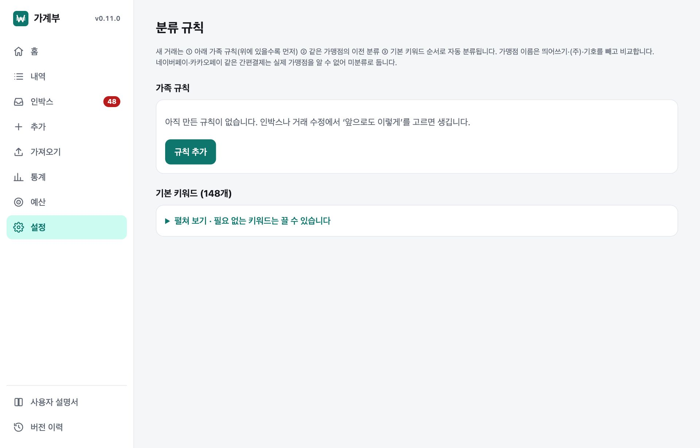

- **자동 분류 순서**: ① 가족 규칙(위에 있는 것 먼저) → ② 같은 가맹점의 이전 분류 → ③ 기본 키워드 순서로 정합니다. 간편결제(페이)는 실제 가맹점을 알 수 없어 미분류로 둡니다.
- **가족 규칙**: 「규칙 추가」에서 가맹점 이름에 들어갈 글자(예: 스타벅스), 조건(포함·일치·시작), 분류를 정합니다. 「미분류에 적용」으로 지금 미분류인 거래에도 바로 적용합니다.
- **기본 키워드**: 앱에 미리 들어 있는 키워드입니다. 펼쳐서 필요 없는 키워드를 눌러 끌 수 있습니다.

> **알아 두면 좋아요**: 인박스나 거래 수정에서 「앞으로도 이렇게」를 고르면 규칙이 저절로 생깁니다.

---

## 8-6. 고정지출 — 매달 나가는 돈 챙기기

_관리비, 통신요금, 보험료처럼 매달 나가는 돈이 이번 달에 나갔는지 확인합니다._

**언제 쓰나요?** 자동으로 찾은 후보를 확인하거나, 고정지출을 직접 더할 때 씁니다.

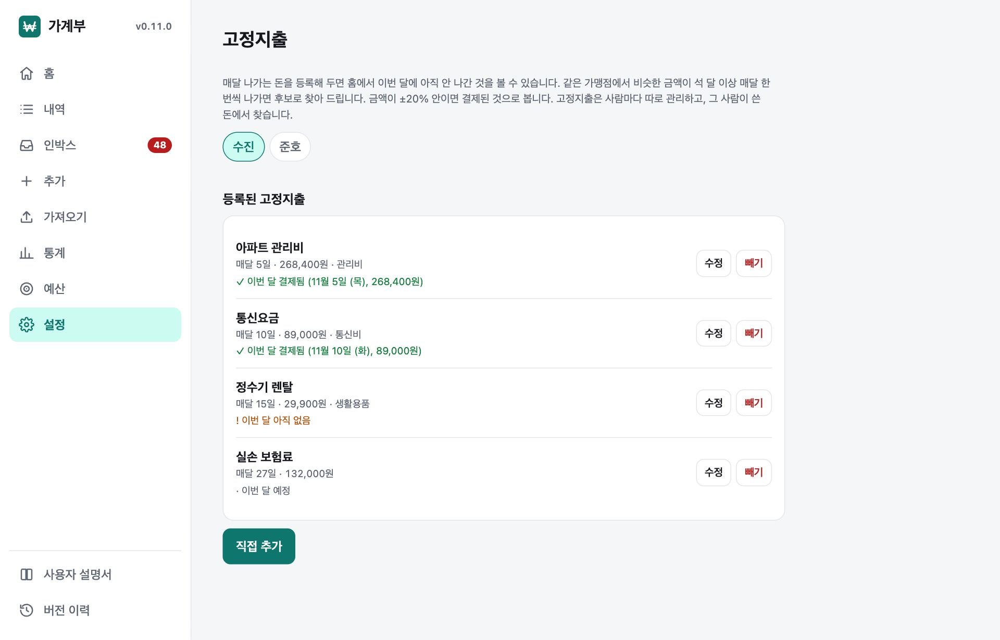

- **확인할 후보**: 내 거래에서 같은 가맹점에 비슷한 금액(±20%)이 석 달 이상 연속으로 매달 한 번씩 나가면 후보로 보여 줍니다. 「등록」하거나, 아니면 「아니에요」를 눌러 다시 묻지 않게 합니다.
- **등록된 고정지출**: 이번 달 「✓ 결제됨」, 「· 예정」, 「! 아직 없음」으로 상태를 보여 줍니다. 가맹점 이름이 맞고 금액이 ±20% 안인 결제가 들어오면 자동으로 결제됨이 됩니다.
- **직접 추가**: 이름, 금액, 매달 결제일, 분류, 결제 수단, 가맹점 이름에 들어 있는 글자(2자 이상)를 넣습니다.
- **사람마다 따로**: 고정지출은 사람마다 따로 관리하고, 그 사람의 결제로 「결제됨」을 판단합니다. 관리자는 위쪽 이름 버튼으로 구성원의 고정지출을 보고 관리할 수 있습니다.

---

## 8-7. 백업·내보내기 — CSV로 받기

_거래를 엑셀에서 열 수 있는 CSV 파일로 받고, 관리자는 백업 상태를 봅니다._

**언제 쓰나요?** 엑셀로 따로 정리하고 싶거나, 백업이 잘 되는지 확인할 때 씁니다.

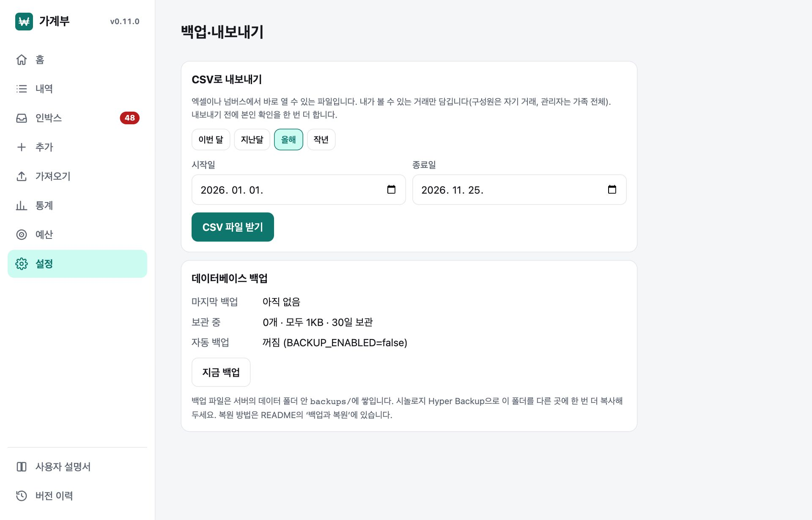

- **CSV로 내보내기**: 이번 달 / 지난달 / 올해 / 작년을 누르거나 시작일·종료일을 고르고 「CSV 파일 받기」를 누릅니다. 엑셀이나 Numbers에서 바로 열리고, 내가 볼 수 있는 거래만 담깁니다.
- **데이터베이스 백업 (관리자)**: 마지막 백업 시각과 크기, 보관 중인 백업 수, 다음 자동 백업 시각을 봅니다. 「지금 백업」으로 바로 백업할 수 있습니다.

---

## 8-8. 구성원 — 가족 초대 (관리자)

_가족을 초대하고 역할을 정합니다. 관리자에게만 보입니다. 관리자는 가족 모두의 거래·카드·예산을 볼 수 있고, 구성원은 자기 것만 봅니다._

**언제 쓰나요?** 가족을 새로 초대하거나, 관리자를 한 명 더 두고 싶을 때 씁니다.

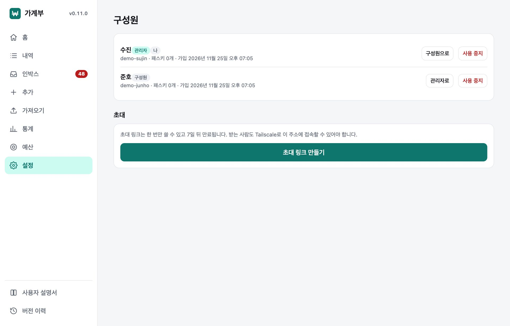

- **초대 링크**: 「초대 링크 만들기」로 링크를 만들어 「공유·복사」로 보냅니다. 링크는 한 번만 쓸 수 있고 7일 뒤 만료됩니다. 받는 사람의 기기도 Tailscale에 연결되어 있어야 합니다.
- **역할과 사용 중지**: 「관리자로」, 「구성원으로」로 역할을 바꾸고, 「사용 중지」로 모든 기기에서 로그아웃시킵니다. 관리자는 최소 한 명 남아 있어야 합니다.

> **알아 두면 좋아요**: 관리자를 두 명 두면 한 사람이 로그인 수단을 모두 잃어도 다른 관리자가 다시 초대할 수 있습니다.

---

## 9. 로그인·잠금 — Face ID로 바로 들어가기

_패스키(Face ID·Touch ID)나 비밀번호로 로그인하고, 잠긴 앱을 엽니다._

**언제 쓰나요?** 새 기기에서 처음 들어가거나, 비밀번호를 잊었을 때 봅니다.

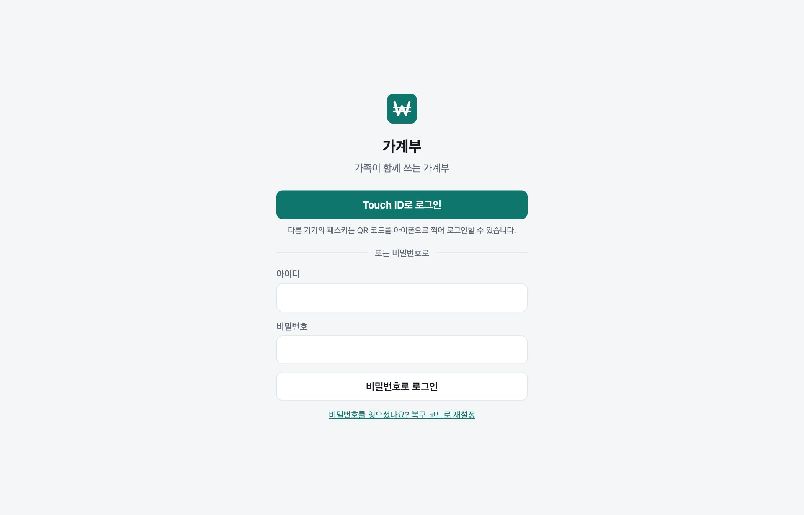

- **패스키로 로그인**: 「Face ID로 로그인」(기기에 따라 Touch ID, Windows Hello)을 누르면 아이디 없이 바로 들어갑니다. PC에서는 나오는 QR 코드를 아이폰으로 찍어 로그인할 수도 있습니다.
- **비밀번호로 로그인**: 아이디와 비밀번호를 넣습니다. 5번 틀리면 15분 동안 비밀번호 로그인이 막히고, 계속 틀리면 더 길어집니다. 패스키 로그인은 막히지 않습니다.
- **비밀번호를 잊었을 때**: 「비밀번호를 잊으셨나요? 복구 코드로 재설정」에서 아이디와 복구 코드로 새 비밀번호를 정합니다. 그 뒤 새 복구 코드가 나오니 다시 저장하세요.
- **앱 잠금**: 정한 시간이 지나면 「잠겨 있습니다」 화면이 나옵니다. Face ID나 비밀번호로 풀면 하던 화면 그대로 이어집니다.

> **알아 두면 좋아요**: 30일 동안 쓰지 않으면 자동으로 로그아웃됩니다. 다른 앱으로 넘어가면 금액이 보이지 않게 화면을 가립니다.

---

## 10. 버전 이력 — 새로 바뀐 것 확인하기

_버전마다 무엇이 새로 생기고 바뀌었는지 정리해 둔 화면입니다._

**언제 쓰나요?** 「새 버전이 준비됐습니다」 안내를 보고 무엇이 바뀌었는지 궁금할 때 엽니다.

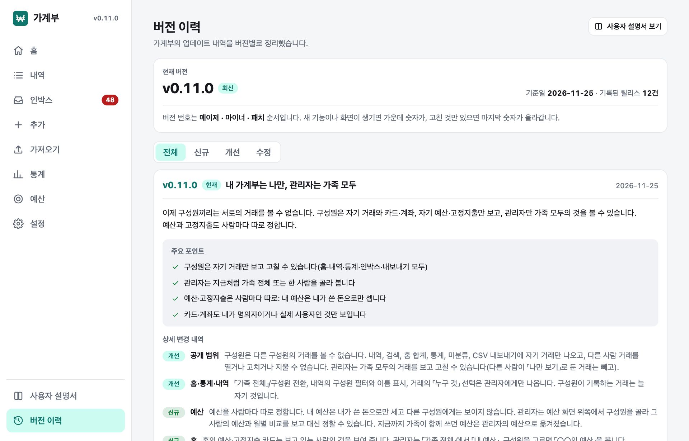

- **현재 버전**: 맨 위에 지금 쓰는 버전이 나옵니다. 사이드바의 「가계부」 옆과 휴대폰 「더보기」에서도 볼 수 있습니다.
- **신규 · 개선 · 수정**: 위쪽 버튼으로 새로 생긴 것, 좋아진 것, 고친 것만 골라 볼 수 있습니다.
- **새 버전 받기**: 새 버전이 나오면 화면 아래에 「새 버전이 준비됐습니다」가 뜹니다. 「지금 업데이트」를 누르거나, 「나중에」를 누른 뒤 앱을 완전히 닫았다 다시 열면 바뀝니다.

---

## 용어 풀이

| 용어 | 뜻 |
| --- | --- |
| **이체** | 카드 대금 납부나 내 통장 사이의 이동입니다. 실제로 쓴 돈이 아니라서 모든 합계에서 빠집니다. |
| **취소** | 취소된 결제입니다. 합계에서 빠집니다. 일부만 취소되면 남은 금액만 셉니다. |
| **확인 필요** | 중복이거나 내용이 애매해서 한 번 봐 달라는 표시입니다. 합계에는 들어갑니다. |
| **자동 등록** | 결제 문자로 저절로 들어온 거래의 상태입니다. 직접 고를 수는 없습니다. |
| **미분류** | 아직 분류를 정하지 않은 거래입니다. 인박스에서 한 번에 정리할 수 있습니다. |
| **확인됨** | 결제 문자와 파일처럼 두 곳 이상에서 같은 거래가 확인됐다는 표시입니다. |
| **패스키** | 비밀번호 대신 Face ID·Touch ID·Windows Hello로 로그인하는 방법입니다. 기기에 안전하게 저장됩니다. |
| **복구 코드** | 비밀번호를 잊었을 때 쓰는 XXXX-XXXX-XXXX-XXXX 모양의 코드입니다. 처음에 한 번만 보여 주니 꼭 따로 적어 두세요. |
| **토큰** | 아이폰 단축어가 문자를 보낼 때 쓰는 기기별 열쇠입니다. 기기를 잃어버리면 문자 전달에서 폐기합니다. |
| **결제월** | 신용카드로 쓴 돈이 실제로 통장에서 빠져나가는 달입니다. 카드의 결제일과 이용기간 마감일로 계산합니다. 결제일 25일 카드라면 11월 5일에 쓴 돈은 11월 25일에, 11월 25일에 쓴 돈은 12월 25일에 나갑니다. |
| **간편결제** | 카카오페이·네이버페이처럼 카드나 통장을 연결해 두고 쓰는 결제수단입니다. 카드·계좌와 구분해 볼 수 있습니다. |
| **한 달의 기준** | 기기의 시간대와 상관없이 한국 시간으로 1일 0시부터 셉니다. 11월 1일 0시 30분 결제는 11월에 들어갑니다. |

---

## 자주 묻는 질문

**Q. 결제했는데 문자가 가계부에 안 들어왔어요.**  
A. 지금은 신한·KB국민·삼성카드 문자만 읽습니다. 아이폰의 Tailscale 연결이 끊겨 있었거나 단축어 자동화가 꺼져 있었을 수도 있습니다. 빠진 거래는 직접 추가하거나, 한 달에 한 번 카드사 파일을 가져오기로 올리면 채워집니다.

**Q. 같은 파일을 두 번 올렸어요. 거래가 두 배가 되나요?**  
A. 아니요. 한 번 가져온 줄은 기억해 두어 다시 들어가지 않습니다. 기간이 겹치는 파일을 올려도 괜찮습니다.

**Q. 파일을 잘못 가져왔어요.**  
A. 가져오기 화면 아래 「가져오기 기록」에서 그 파일의 「가져오기 취소」를 누르면 되돌아갑니다.

**Q. 지운 거래를 되살릴 수 있나요?**  
A. 아니요, 삭제는 되돌릴 수 없습니다. 합계에서만 빼고 싶다면 삭제 대신 상태를 「취소」로 바꾸세요.

**Q. 홈의 합계가 카드 명세서와 달라요.**  
A. 가계부 합계에서는 이체(카드 대금 납부, 내 계좌 이동)와 취소된 결제가 빠집니다. 또 한 달은 한국 시간 1일 0시부터 말일까지로 셉니다. 카드 명세서는 결제일 기준이라 다를 수 있습니다. 내역에서 「결제월 기준」을 누르면 명세서처럼 결제월로 모아 볼 수 있습니다(카드에 결제일을 넣어 두어야 합니다).

**Q. 가져온 거래의 수단이 「—」로 비어 있어요.**  
A. 가져올 때 결제수단을 카드·계좌에 연결하지 않아서 그렇습니다. 「설정 → 카드·계좌」 맨 위의 「가져온 파일의 결제수단 연결」에서 이름마다 종류를 고르고 「연결」을 누르면 한꺼번에 채워집니다.

**Q. 가족이 내 거래를 볼 수 있나요?**  
A. 다른 구성원은 내 거래를 볼 수 없습니다. 구성원은 자기 거래, 자기 카드·계좌, 자기 예산·고정지출만 봅니다. 관리자만 가족 모두의 것을 볼 수 있고, 홈과 통계에서 한 사람 이름을 눌러 그 사람 것만 따로 볼 수 있습니다. 분류와 분류 규칙은 가족이 함께 씁니다.

**Q. 비밀번호도, 복구 코드도 잊었어요.**  
A. 패스키(Face ID)로 로그인할 수 있다면 「설정 → 보안」에서 비밀번호를 새로 정하고 새 복구 코드도 만드세요. 패스키도 없다면 관리자에게 새 초대 링크를 요청하세요.

**Q. 휴대폰에 앱처럼 설치하려면요?**  
A. 아이폰·아이패드는 Safari의 공유 → 「홈 화면에 추가」, 맥은 Safari의 파일 → 「Dock에 추가」, PC는 Chrome·Edge 주소창의 「앱 설치」 아이콘을 누르세요.

**Q. 「새 버전이 준비됐습니다」가 떠요.**  
A. 「지금 업데이트」를 누르면 바로 새 버전으로 바뀝니다. 「나중에」를 눌러도 다음에 앱을 열 때 저절로 바뀝니다. 무엇이 바뀌었는지는 「버전 이력」에서 볼 수 있습니다.
